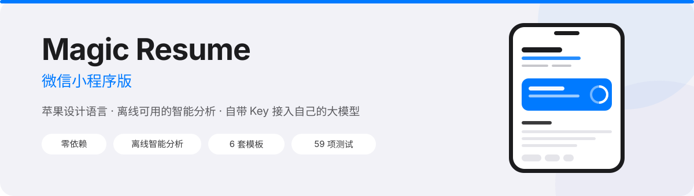

<div align="center">



<p>
  
  
  
  
  
</p>

<p>
  <b>一款原生微信小程序简历工具</b><br/>
  苹果设计语言 · 完全离线的智能分析 · 也可以接你自己的大模型
</p>

</div>

---

## 这是什么

把开源简历工具 [Magic Resume](https://github.com/JOYCEQL/magic-resume) 重做成**原生微信小程序**。

不是 WebView 套壳，没有构建步骤，没有第三方 UI 库 —— 打开就是编译器，改一行代码立刻能看到效果。

原版是 Web 应用，需要浏览器、需要部署。但投简历这件事，绝大多数发生在微信里：看到一条 JD、想改一版、发出去 —— 这几个动作不该离开聊天窗口。

## 为什么值得一试

| | 常见简历工具 | 这个 |
|---|---|---|
| 打开方式 | 浏览器 / 下载 App | 微信里点开就用 |
| 智能能力 | 要么没有，要么必须联网付费 | **两套都有：离线规则引擎 + 可选的大模型** |
| 简历数据 | 上传到别人的服务器 | **一个字节都不出手机** |
| 导出 | 付费解锁 PDF | 免费导高清长图，带脱敏和水印 |
| 代码 | 闭源 | 全部源码，59 项离线测试，随便改 |

## 核心能力

### 双通道智能

同一套界面下，两种算力来源，界面会自动切换：

| | 本地规则引擎 | 接入自己的大模型 |
|---|---|---|
| 需要联网 | 否 | 是 |
| 需要 API Key | 否 | 是（自己的） |
| 数据去向 | 不离开手机 | 直连厂商，不经任何中转服务器 |
| 成本 | 0 | 按厂商计费 |
| 适合 | 反复体检、快速迭代 | 深度分析、逐条重写 |

### 本地引擎：不联网也能用

关键词抽取用了三路融合 —— 词库命中（权重 3.0）+ 中文 n-gram 频率（1.4）+ 英文词元（1.6），再按「2 字窗口部分命中」处理分词差异。

- **JD 匹配雷达** —— 粘贴招聘要求，算出匹配度、命中的词、缺的词，能一键把缺词补进技能区
- **ATS 机筛体检** —— 14 项加权检查：联系方式可解析、强动词开头、成果量化率、单条长度、页数、求职状态……
- **面试官模拟** —— 从你的经历里找「重构 / 性能 / 灰度 / 主导 / 降级」这类触发点，生成定向追问，附考察意图
- **STAR 改写** —— 弱动词升级、去第一人称、补方法链路，一次给 3 个候选
- **时间线体检** —— 自动查倒序、结束早于开始、空档期、经历重叠
- **成长徽章** —— 8 枚成就，把优化简历这件事做出进度感

一个真实数据：一段堆满「WordPress / Shopify / 页面装修」的建站岗 JD，旧版抽取器只会吐出 51 个碎片词、匹配度恒为 0；重写后抽出 23 个干净关键词，匹配度 18% —— 这个低分是**对的**，因为那份简历确实是前端背景投建站岗。

### 排版与导出

- **6 套模板**：经典 / 极简 / 雅致 / 创意 / 瑞士 / 时间轴，缩略图是真实简历的迷你版
- **实时预览**：右改左看，APP 里改完立刻能看排版结果
- **Canvas 导出长图**：两遍绘制（先量真实高度，再按高度重绘），不会溢出也不会留白
- **隐私脱敏**：手机号、邮箱打码后再导出
- **防泄漏水印**：自定义文字平铺，用来追踪简历流向

### 投递闭环

- **多版本投递** —— 一份经历派生「前端岗 / 产品岗 / 考研」多个版本，任意一点可查看
- **投递漏斗** —— 已投递 → 被查看 → 面试 → Offer 的转化率
- **电子名片** —— 生成 1080 宽的名片图，可附 30 秒语音自我介绍

## 技术实现

```
页面层（8 个页面 + 2 个组件）
        │
        ├── utils/ai.js      本地分析引擎：关键词抽取 / ATS / 面试题 / STAR / 时间线
        ├── utils/llm.js     大模型接入：6 家厂商、模型拉取、SSE 流式
        ├── utils/render.js  Canvas 导出 + Markdown 生成
        ├── utils/md.js      Markdown → rich-text（全内联样式）
        └── utils/store.js   数据模型 / 多版本 / 投递追踪 / 本地持久化
```

几个值得一提的实现细节：

- **Canvas 双 API 兼容** —— `type="2d"` 的新 Canvas 不认旧的 `setFillStyle / setFontSize`，封装了 `setFill / setFont` 同时走两套，新旧基础库都不会白屏
- **SSE 流式解析** —— `onChunkReceived` 在真机上给的是 `ArrayBuffer`（开发者工具里是字符串），手写了 UTF-8 解码器；而且一行 SSE 可能被切在两个 chunk 之间，用跨包缓冲只处理完整的行
- **rich-text 全内联样式** —— 小程序 `rich-text` 的内部节点不继承页面 WXSS，所以每个标签都带 `style`，且列表降级成「带前缀的段落」以兼容不渲染项目符号的基础库

## 快速开始

```bash
git clone <this-repo>
```

用**微信开发者工具**导入 `resume-mp` 目录，AppID 选测试号即可。

首次启动会自动生成两份简历：「魔方样板」（完整示例数据）和一份空白简历。

想用真实大模型，去 **我的 → AI 服务商** 填一个 Key，支持 DeepSeek / OpenAI / 通义千问 / 豆包 / Kimi，以及任何兼容 OpenAI 协议的服务（Ollama、vLLM、OneAPI 都行）。

> 用自己的域名前，要在「微信公众平台 → 开发管理 → 服务器域名 → request 合法域名」里加上厂商域名；本地调试可以在开发者工具里勾选「不校验合法域名」。

## 测试

```bash
node tests/smoke.js
```

59 项断言，**全部离线**，不需要网络也不需要 API Key：

- 数据模型 CRUD、多版本、投递追踪
- 关键词抽取质量、JD 评分区分度（技术岗 83%，无关岗位 18%）
- ATS 打分（含「负责开头判弱动词」这类边界）
- Canvas 导出、Markdown 生成
- 大模型请求构造（URL / 鉴权头 / payload）
- SSE 流式解析（字符串 chunk、跨包半行、ArrayBuffer chunk、中文与 emoji 解码）
- Markdown → rich-text（内联样式、列表降级、HTML 注入转义）

做法是把 `wx` 和 `wx.request` 都 mock 掉，再用 Proxy 模拟 canvas context，所以改完逻辑能立刻验证。

## 目录结构

```
resume-mp/
├── app.wxss                 Apple Design System：排版阶梯 / 语义色 / 卡片 / Sheet / 缓动
├── app.json                 8 个页面 + 自定义 tabBar
├── components/
│   ├── ring/                iOS「健康」式环形进度（conic-gradient + 数值补间）
│   └── navbar/              苹果风导航栏（带返回；tab 页用作状态栏占位）
├── custom-tab-bar/          毛玻璃标签栏，图标纯 CSS 绘制
├── utils/                   ai / llm / md / render / store
├── tests/smoke.js           59 项离线测试
├── docs/                    横幅与推广文案
└── pages/
    ├── index/               工作台：完成度、版本切换、建议、徽章
    ├── editor/              编辑器：分组列表 + 底部 Sheet 表单
    ├── preview/             预览：6 套模板实时渲染、导出长图
    ├── insight/             AI 洞察：AI 深度分析 / JD 雷达 / ATS / 面试官 / STAR
    ├── ai/                  AI 服务商配置
    ├── templates/           模板库 + 主题色
    ├── trace/               投递漏斗
    ├── share/               电子名片 + 声纹自我介绍
    └── mine/                微信授权、版本管理、数据导入导出
```

## 设计语言

严格照着 iOS Human Interface Guidelines 做：

- **颜色**取自系统色：`#007AFF` `#34C759` `#5856D6` `#FF9500` `#FF3B30` `#AF52DE`
- **背景**用分组灰 `#F2F2F7`，卡片纯白 + 28rpx 圆角 + 极低饱和阴影
- **排版**按 iOS Type Scale：Large Title 68rpx 到 Caption 24rpx
- **动效**统一 `cubic-bezier(.32, .72, 0, 1)`（系统曲线），交互反馈用带回弹的 `.34, 1.56, .64, 1`
- **材质**标签栏与底栏用 `backdrop-filter` 毛玻璃

## 踩过的坑（给做小程序的人）

这些坑都不报错，只会让界面莫名错位，写在这希望能省你几个小时：

1. **`env()` 必须带 fallback** —— `calc(100rpx + env(safe-area-inset-bottom))` 在不支持 `env()` 的基础库上**整条声明作废**，`bottom` 退化成 `auto`，固定底栏会跑到屏幕顶部
2. **WXSS 同名类会静默互相覆盖** —— 我一度把「缩略图顶部细线」和「固定底栏」都叫 `.tp-bar`，结果底栏飞到页面顶部、缩略图糊成大色块
3. **tabBar 页面不能带参跳转** —— `wx.navigateTo('/pages/x/x?tab=1')` 对 tab 页会失败且参数丢失，得走 `switchTab` + 全局中转
4. **`wx:for` 不写 `wx:for-item` 时默认叫 `item`** —— 模板里写 `v.xxx` 会静默渲染成空白
5. **WXML 不支持 `obj[dynamicKey]`** —— 动态取值一律在 JS 里拍平成数组
6. **`rich-text` 内部不继承页面样式** —— 所有样式必须内联
7. **竖向滚动别用固定高度的 `scroll-view`** —— 高度算不准还会双层滚动，交给页面原生滚动

## 已知限制

- 需要**微信开发者工具**导入运行，没有 Web 版在线体验
- 导出的是**高清长图**，不是 PDF（做 PDF 需要服务端）
- 语音自我介绍只能在本机播放，没有云端存储
- 大模型走直连，需要自己在小程序后台配 request 合法域名

## 许可与归属

本项目是 [Magic Resume](https://github.com/JOYCEQL/magic-resume)（作者 [JOYCEQL](https://github.com/JOYCEQL)）的**衍生作品**，基于 Apache License 2.0，并**继承上游的附加商业限制条款**。

上游条款摘要：

- ✅ 个人非商业用途（学习交流、做自己的简历）免费使用
- ❌ **禁止**作为 SaaS / 网站工具等网络服务向公众提供以获取商业利益
- ❌ **禁止**嵌入商业软件、闭源产品或企业内部系统
- ❌ **禁止**二次开发后用于商业运营（包括改名字、换 logo）
- 📧 商业使用需提前联系原作者获取授权

换句话说：**拿去给自己做简历、学习小程序开发、提交 PR 都可以；想拿它赚钱，先去找原作者谈授权。**

本项目的 UI 重做、本地分析引擎、大模型接入层、Canvas 导出、测试套件为新增实现，同样遵循上述条款。

## 致谢

- [JOYCEQL/magic-resume](https://github.com/JOYCEQL/magic-resume) —— 原项目，模板设计与数据结构参考自此
- 内置示例数据取自原项目的 `initialResumeData.ts`（宋哈娜 / 高级前端工程师）
- 设计语言参考 Apple Human Interface Guidelines
